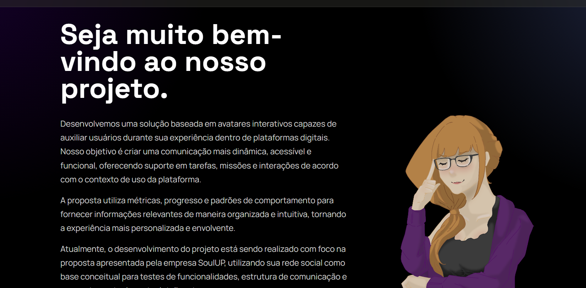
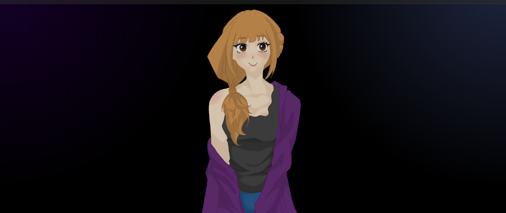
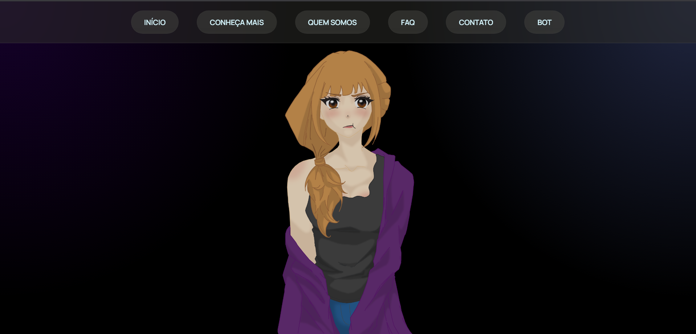
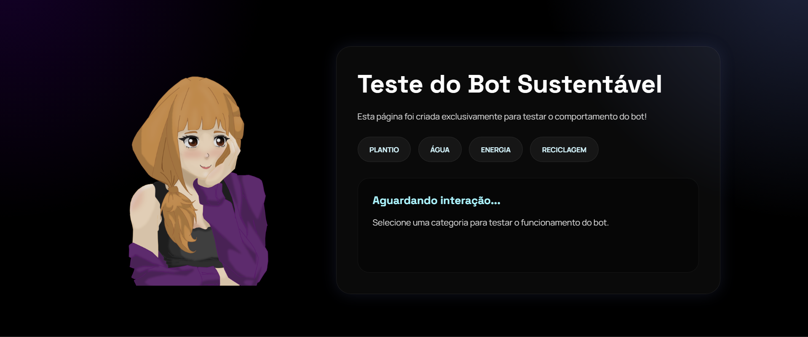

# challenge
Entregas das sprints referentes ao challenge

Bot Kaori

A Kairós propõe um Bot de Sustentabilidade inteligente integrado a uma plataforma de missões gamificadas. A solução diferencia-se através de uma arquitetura inovadora denominada "Sistema Híbrido Determinístico + Generativo" com personalização por IA.

Componentes Principais da Solução:

1. Bot Inteligente com Resposta Personalizada: Diferente de chatbots convencionais, o Bot de Kairós não gera respostas livres. Em vez disso: (a) identifica a categoria de ação realizada; (b) recupera cenários pré-definidos do banco de dados (100+ mensagens base); (c) utiliza IA apenas para reescrever o texto em variações naturais, evitando repetição aparente.

2. Arquitetura Híbrida Escalável: O sistema combina lógica determinística (triggers, regras, banco de dados) com camada generativa limitada (reescrita por IA).

Tecnologias:

HTML5 → utilizado para a estruturação das páginas do site.
CSS3 → utilizado para estilização, layout, responsividade e design visual da interface.
JavaScript → utilizado para interatividade, manipulação de elementos da página e funcionalidades dinâmicas.
Imagens e recursos gráficos → utilizados para composição visual e identidade do projeto.
VS Code (Visual Studio Code) → editor de código utilizado durante o desenvolvimento.
Navegador Web → utilizado para testes e validação do funcionamento das páginas.

Imagens do Projeto:
   

ORGANIZAÇÃO
Pastas e Subpastas

Sendo elas definidas por:

Texto

Estilização

Midia

Programação

Participantes:

1ºTDSPI

Artur da Silva de Oliveira
RM: 569870

Guilherme Gomes Nogueira
RM: 569481

Renata Moron Castropil
RM: 569508

Repositório
https://github.com/OlivaTvOS/challenge/tree/front-end

Contato:

Artur: olivaovso@gmail.com

Guilherme: guign1610@gmail.com

Renata: renatamoron1406@gmail.com